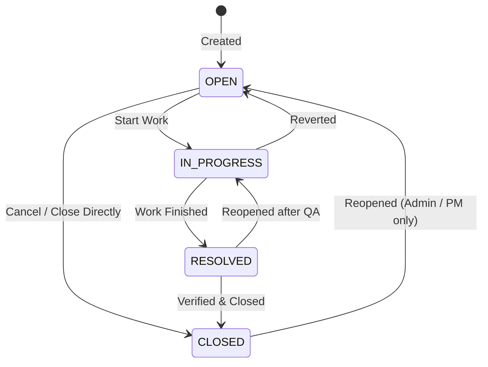

# AI Issue Management System — Non-AI Foundation

A production-grade, secure, modular monolith backend foundation for an **AI Issue Management System** built with **Java 21**, **Spring Boot 4.1.x**, **Spring Data JPA**, **PostgreSQL**, **Spring Security**, and **OpenAPI/Swagger UI**.

---

## 1. Architecture Overview (Modular Monolith)

The system is architected as a single deployable Spring Boot modular monolith. Each business capability resides in a dedicated module with its own domain entities, DTOs, repositories, services, and REST controllers:

```
com.issuemanagement
├── common
│   ├── config          # OpenAPI / Swagger and system configurations
│   ├── dto             # Standard ApiResponse, PageResponse
│   └── exception       # Centralized GlobalExceptionHandler and custom business exceptions
├── identity
│   ├── controller      # AuthController (Login) and UserController (CRUD, Status)
│   ├── dto             # Auth and User requests/responses
│   ├── entity          # User entity and Role enum (ADMIN, PROJECT_MANAGER, EMPLOYEE)
│   ├── repository      # UserRepository
│   ├── security        # JWT token provider, filters, and SecurityUtils
│   └── service         # AuthService, UserService
├── project
│   ├── controller      # ProjectController (CRUD, Manager Assignment, Members, Archival)
│   ├── dto             # Project and Member requests/responses
│   ├── entity          # Project, ProjectMember, ProjectStatus
│   ├── repository      # ProjectRepository, ProjectMemberRepository
│   └── service         # ProjectService, ProjectAuthorizationService
├── issue
│   ├── controller      # IssueController (CRUD, Filtering, Workflow, Archival)
│   ├── dto             # Issue requests/responses
│   ├── entity          # Issue, IssueType, IssuePriority, IssueStatus
│   ├── repository      # IssueRepository
│   └── service         # IssueService
├── comment
│   ├── controller      # CommentController (CRUD on issue comments)
│   ├── dto             # Comment requests/responses
│   ├── entity          # IssueComment
│   ├── repository      # IssueCommentRepository
│   └── service         # CommentService
├── history
│   ├── controller      # History endpoints
│   ├── dto             # IssueHistoryResponse
│   ├── entity          # IssueHistory, ChangeType
│   ├── repository      # IssueHistoryRepository
│   └── service         # IssueHistoryService
└── audit
    ├── controller      # AuditController (Admin audit log views)
    ├── dto             # AuditLogResponse
    ├── entity          # AuditLog
    ├── repository      # AuditLogRepository
    └── service         # AuditService
```

---

## 2. Business Roles & Permission Matrix

The application defines exactly three primary roles:

| Capability / Action | ADMIN | PROJECT_MANAGER | EMPLOYEE |
|---------------------|:-----:|:---------------:|:--------:|
| Authenticate / Login | Yes | Yes | Yes |
| Create User Account | Yes | No | No |
| Activate / Deactivate Users | Yes | No | No |
| View Users List | Yes | No | No |
| Create Project | Yes | No | No |
| Assign / Reassign Project Manager | Yes | No | No |
| Archive Project | Yes | No | No |
| View Projects | All Projects | Assigned Projects Only | Member Projects Only |
| Update Project Details (Name, Description) | Yes | Yes (Assigned Only) | No |
| Add / Remove Regular Project Members | Across All Projects | Assigned Project Only | No |
| Create Issue | Yes | Yes (Assigned) | Yes (Member Projects) |
| View Issues | All Issues | Assigned Projects | Member Projects |
| Assign Issue to Eligible Member | Yes | Yes (Assigned) | No |
| Update Issue Details (Title, Description, Priority) | Yes | Yes (Assigned) | Yes (Reporter/Assignee) |
| Transition Issue Status | Yes | Yes (Assigned) | Yes (Reporter/Assignee) |
| Reopen Closed Issue (`CLOSED` -> `OPEN`) | Yes | Yes (Assigned) | No |
| Archive / Soft-Delete Issue | Yes | Yes (Assigned) | No |
| Add Comment | Yes | Yes (Assigned) | Yes (Member Projects) |
| Edit Comment | Admin / Author | Author Only | Author Only |
| Delete Comment | Yes | Yes (Assigned) | Author Only |
| View System Audit Logs | Yes | No | No |

---

## 3. Workflow & Issue State Transitions

Issue statuses follow a strict, validated finite state machine. Arbitrary status jumps are rejected with clear business errors (`400 Bad Request`):



- **OPEN**: Can transition to `IN_PROGRESS` or `CLOSED`.
- **IN_PROGRESS**: Can transition to `RESOLVED` or revert to `OPEN`.
- **RESOLVED**: Can transition to `CLOSED` or revert to `IN_PROGRESS`.
- **CLOSED**: Terminal state. Can only be reopened back to `OPEN` by an `ADMIN` or the assigned `PROJECT_MANAGER`.

---

## 4. Database Schema (PostgreSQL & Spring Data JPA)

Database schema is managed via Hibernate DDL auto-generation (`spring.jpa.hibernate.ddl-auto=update`):

- `users`: User identity, hashed passwords, roles (`ADMIN`, `PROJECT_MANAGER`, `EMPLOYEE`), active status, and `password_change_required` flag.
- `projects`: Project key (`UNIQUE`), name, manager assignment (`manager_id`), status (`ACTIVE`, `ARCHIVED`).
- `project_members`: Join table linking projects and employees with a `UNIQUE(project_id, user_id)` constraint.
- `issues`: Issue key (`UNIQUE`, e.g. `CORE-1`), title, description, type, priority, status, reporter, assignee (`nullable`), and soft-deletion flag `archived`.
- `issue_comments`: Comments linked to issues and authors with timestamps.
- `issue_history`: Immutable change history recording actor, change type (`CREATED`, `STATUS_CHANGED`, `PRIORITY_CHANGED`, `ASSIGNEE_CHANGED`, `UPDATED`, `ARCHIVED`), old value, and new value.
- `audit_logs`: Administrative event logging.

No static/hardcoded administrator accounts are seeded. The application uses the Admin Registration API (`POST /api/v1/auth/register-admin`) to securely bootstrap the single initial administrator account.

---

## 5. API Endpoints & Swagger / OpenAPI Documentation

Interactive Swagger UI and OpenAPI documentation are available out of the box with JWT Bearer token authentication:

- **Swagger UI:** `http://localhost:8080/swagger-ui.html`
- **OpenAPI JSON Docs:** `http://localhost:8080/v3/api-docs`

### Key API Routes:

#### Authentication & Identity
- `POST /api/v1/auth/register-admin` (alias `/api/v1/auth/register`) — Register the initial administrator account (only one admin registration permitted without secret key; returns user info only)
- `POST /api/v1/auth/login` — Authenticate and receive JWT Bearer token (returns `passwordChangeRequired` flag)
- `POST /api/v1/auth/change-password` — Set a new unique password (required on first login for accounts with `passwordChangeRequired = true` before normal APIs can be used)
- `POST /api/v1/users` — Create user (Admin only)
- `GET /api/v1/users` — Paginated user list with role filtering (Admin only)
- `GET /api/v1/users/{userId}` — Get user details (Admin or self)
- `PATCH /api/v1/users/{userId}` — Update user details (Admin or self)
- `PATCH /api/v1/users/{userId}/status` — Activate/deactivate user account (Admin only)
- `GET /api/v1/users/eligible/employees` — List active employees eligible for project assignment
- `GET /api/v1/users/eligible/managers` — List active project managers (Admin only)

#### Project Management
- `POST /api/v1/projects` — Create project with assigned active PM (Admin only)
- `GET /api/v1/projects` — List projects scoped to user permissions (Admin: all, PM: managed, Employee: member)
- `GET /api/v1/projects/{projectId}` — Get project details (Authorized users)
- `PATCH /api/v1/projects/{projectId}` — Update project name/description (Admin or assigned PM)
- `PUT /api/v1/projects/{projectId}/manager` — Reassign project manager (Admin only)
- `GET /api/v1/projects/{projectId}/members` — List members in project
- `POST /api/v1/projects/{projectId}/members` — Add employee to project (Admin or assigned PM)
- `DELETE /api/v1/projects/{projectId}/members/{userId}` — Remove employee from project (Admin or assigned PM)
- `POST /api/v1/projects/{projectId}/archive` — Archive project (Admin only)

#### Issue Management & History
- `POST /api/v1/projects/{projectId}/issues` — Create issue in project
- `GET /api/v1/projects/{projectId}/issues` — List issues in project with filtering (`status`, `priority`, `type`, `assigneeId`) and pagination (used for manager & drill-down views)
- `GET /api/v1/issues/{issueId}` — Get issue details
- `PATCH /api/v1/issues/{issueId}` — Update issue details
- `PUT /api/v1/issues/{issueId}/assignee` — Assign/reassign issue to eligible project member
- `PATCH /api/v1/issues/{issueId}/status` — Transition issue status according to workflow rules
- `POST /api/v1/issues/{issueId}/reopen` — Reopen issue (including `CLOSED`) with reason comment (Active project members, assigned PM, or Admin)
- `POST /api/v1/issues/{issueId}/archive` — Archive issue (Admin or assigned PM)
- `DELETE /api/v1/issues/{issueId}` — Soft delete / archive issue (Admin or assigned PM)
- `GET /api/v1/issues/{issueId}/history` — View complete change history and audit trail for an issue

#### Dashboards
- `GET /api/v1/dashboard/employee` — Personal workload dashboard for the authenticated employee
- `GET /api/v1/projects/{projectId}/dashboard` — Project manager operational dashboard for assigned PM or Admin

#### Comments
- `POST /api/v1/issues/{issueId}/comments` — Add comment to accessible issue
- `GET /api/v1/issues/{issueId}/comments` — List comments for an issue
- `PATCH /api/v1/comments/{commentId}` — Edit comment (Author only)
- `DELETE /api/v1/comments/{commentId}` — Delete comment (Author, assigned PM, or Admin)

#### Audit Logs
- `GET /api/v1/audit-logs` — View system audit logs (Admin only)

---

## 6. Dashboards & Workflow Specifications

### 6.1 Employee Dashboard (`GET /api/v1/dashboard/employee`)
- **Authentication:** Determined strictly from the authenticated security context (JWT principal). Clients cannot supply arbitrary user IDs.
- **Aggregation Metrics (Zero N+1):**
  - `totalAssignedIssues`: Count of all issues across accessible projects currently assigned to the logged-in employee.
  - Per-status counts: `openCount`, `inProgressCount`, `resolvedCount`, `closedCount`.
  - Active urgency counts: `highPriorityActiveCount`, `criticalPriorityActiveCount` (for active `OPEN` and `IN_PROGRESS` assigned issues).
  - `activeAssignedIssues`: Prioritized list containing only `OPEN` and `IN_PROGRESS` assigned issues.
- **Priority Ordering:** Deterministic backend ordering:
  `CRITICAL` -> `HIGH` -> `MEDIUM` -> `LOW`, secondary sort by `createdAt DESC`.
- **Isolation:** Unassigned issues and other employees' issues are excluded. If the user has no assigned issues, a consistent empty state is returned.

#### Example Response:
```json
{
  "success": true,
  "message": "Employee dashboard retrieved successfully",
  "data": {
    "employeeId": 12,
    "employeeName": "Jane Doe",
    "employeeEmail": "jane.doe@example.com",
    "totalAssignedIssues": 5,
    "openCount": 2,
    "inProgressCount": 1,
    "resolvedCount": 1,
    "closedCount": 1,
    "highPriorityActiveCount": 1,
    "criticalPriorityActiveCount": 1,
    "activeAssignedIssues": [
      {
        "id": 101,
        "issueKey": "PROJ-101",
        "title": "Payment webhook retry failure",
        "type": "BUG",
        "priority": "CRITICAL",
        "status": "OPEN",
        "projectId": 3,
        "projectKey": "PROJ",
        "projectName": "Core Billing",
        "assigneeId": 12,
        "assigneeName": "Jane Doe",
        "createdAt": "2026-10-16T12:00:00Z",
        "updatedAt": "2026-10-16T12:00:00Z"
      }
    ]
  }
}
```

### 6.2 Project Manager Dashboard (`GET /api/v1/projects/{projectId}/dashboard`)
- **Authorization:** Accessible only by `ADMIN` or the specific `PROJECT_MANAGER` assigned to the project. Other project managers and employees are rejected (`403 Forbidden`).
- **Project Summary Metrics (Zero N+1 Aggregation):**
  - `totalIssues`: Total non-archived issues in the project. Reconciles exactly with `openCount + inProgressCount + resolvedCount + closedCount`.
  - `pendingWorkCount`: Total actionable work (`openCount + inProgressCount`).
  - `highPriorityActiveCount` & `criticalPriorityActiveCount`: Active project-wide urgent issues.
  - `unassignedActiveCount`: Count of `OPEN` and `IN_PROGRESS` issues without an assignee.
  - `unassignedActiveIssues`: Prioritized list of unassigned active issues for rapid triaging.
- **Team Workload Breakdown:**
  - For every current active member in the project: employee ID, full name, email, per-status counts (`open`, `inProgress`, `resolved`, `closed`), total assigned count, and active high/critical counts.
  - Current members with zero assigned issues are included.
  - Inactive employees are excluded from the current team member list while historical assignments remain preserved.
- **Drill-Down Capability:**
  Frontend clients can drill down into any count card or employee workload using the existing query API:
  `GET /api/v1/projects/{projectId}/issues?status={STATUS}&assigneeId={EMPLOYEE_ID}`.

---

### 6.3 Lifecycle & Assignment Cleanup

#### Member Removal from Project (`DELETE /api/v1/projects/{projectId}/members/{userId}`)
- When a user is removed from a project:
  1. All `OPEN` and `IN_PROGRESS` issues assigned to that user **within that project** are unassigned (`assignee = null`).
  2. `RESOLVED` and `CLOSED` issues remain assigned to preserve historical attribution.
  3. An `ASSIGNEE_CHANGED` history entry is recorded for each unassigned issue.
  4. An administrative `MEMBER_REMOVED` audit log entry is recorded.
  5. The entire operation runs within a single atomic `@Transactional` boundary.

#### Account Deactivation (`PATCH /api/v1/users/{userId}/status`)
- When an employee account is deactivated (`active = false`):
  1. `JwtAuthenticationFilter` rejects any subsequent requests using existing or new JWTs (`401 Unauthorized`).
  2. Login is rejected (`401 Unauthorized`).
  3. The user is excluded from active employee eligibility endpoints (`/api/v1/users/eligible/employees`).
  4. All `OPEN` and `IN_PROGRESS` issues assigned to that user **across all projects** are unassigned (`assignee = null`).
  5. `RESOLVED` and `CLOSED` issues, historical records, comments, and project memberships are preserved.
  6. Atomic `@Transactional` execution guarantees full rollback on any failure.

#### Confirmed-Match Issue Reopening (`POST /api/v1/issues/{issueId}/reopen`)
- Allows any active project member, the assigned PM, or an Admin to reopen an issue (including from `CLOSED` to `OPEN`).
- Records an automatic comment with the reopen reason and writes a `STATUS_CHANGED` entry to `issue_history`.

---

## 7. Local Development & Setup

### Prerequisites
- **Java 21 JDK**
- **Maven** (or use the included Maven wrapper `./mvnw.cmd` / `./mvnw`)
- **PostgreSQL 18.x** (running on localhost:5432 or configured via environment variables)

### Configuration
Copy `.env.example` or configure `application.properties`:
```bash
SPRING_DATASOURCE_URL=jdbc:postgresql://localhost:5432/issue_management
SPRING_DATASOURCE_USERNAME=postgres
SPRING_DATASOURCE_PASSWORD=your_password
JWT_SECRET=404E635266556A586E3272357538782F413F4428472B4B6250645367566B5970
JWT_EXPIRATION_MS=86400000
SERVER_PORT=8080
```

### Build & Run
1. **Compile and run all automated tests:**
   ```bash
   .\mvnw.cmd clean test
   ```
2. **Build executable JAR:**
   ```bash
   .\mvnw.cmd package -DskipTests
   ```
3. **Start the application:**
   ```bash
   .\mvnw.cmd spring-boot:run
   ```
4. **Open Swagger UI in your browser:**
   ```
   http://localhost:8080/swagger-ui.html
   ```

---

## 8. Automated Test Suite & Actual Verification Results

Automated test execution against PostgreSQL 18.1:
```bash
.\mvnw.cmd clean test
```
**Results:**
```text
[INFO] Results:
[INFO] 
[INFO] Tests run: 47, Failures: 0, Errors: 0, Skipped: 0
[INFO] 
[INFO] ------------------------------------------------------------------------
[INFO] BUILD SUCCESS
[INFO] ------------------------------------------------------------------------
```

### Test Coverage Breakdown:
1. **`IssueManagementIntegrationTest` (Full E2E against PostgreSQL):**
   - Admin initial login and forced password change.
   - Project creation and assignment to active Project Manager.
   - Adding and removing project members with assignment cleanup.
   - Deactivating employee account and immediate JWT rejection on subsequent requests.
   - Cross-project isolation and RBAC authorization gating.
   - Employee dashboard counts, active priority ordering, and isolation from other users.
   - Project manager dashboard total reconciliation (`OPEN + IN_PROGRESS + RESOLVED + CLOSED`), pending work count, unassigned active issue triage list, and member workload breakdown.
   - Drill-down queries verifying project isolation.
   - Active project member reopening of `CLOSED` issue with history tracking.
2. **`DashboardServiceTest` (Unit Tests):**
   - Employee dashboard aggregation correctness, priority sorting, and empty state handling.
   - Project manager dashboard metrics reconciliation and unauthorized PM rejection.
   - Filtering of inactive employees from current project workload.
3. **`ProjectServiceTest` (13 tests):**
   - Project creation, unique keys, manager assignment, employee eligibility, duplicate membership rejection, archival, and member removal issue unassignment.
4. **`UserServiceTest` (11 tests):**
   - Employee deactivation, cross-project active issue unassignment, preservation of closed/resolved issues, self-deactivation prevention for administrators.
5. **`IssueServiceTest` (8 tests):**
   - Key sequencing (`{PROJECT_KEY}-{N}`), assignee membership verification, status transition tracking, and member reopening.
6. **`IssueStatusTransitionTest` (5 tests):**
   - FSM validation for legal transitions and rejection of illegal state jumps.
7. **`JwtTokenProviderTest` (3 tests):**
   - Production profile startup validation for weak (<256 bit) or default secrets.
8. **`CommentServiceTest` (2 tests):**
   - Authorization gating ensuring only current project members or PM can comment or edit/delete.

---

## 9. Future AI Integration Boundary (Non-AI Foundation)

The system is cleanly structured to support future AI-driven issue deduplication and assistance without coupling core domain services:
- **Duplicate Match Reopening:** `POST /api/v1/issues/{issueId}/reopen` is now available for active project members to confirm and reopen duplicate issues, adding a rationale comment and history record.
- **Service Boundaries:**
  - `IssueService.createIssue()`: Enforces key generation, reporter attribution, and initial state.
  - `CommentService.createComment()`: Enforces project access and author attribution.
  - `ProjectAuthorizationService.checkProjectAccess()`: Ensures all future AI similarity searches and queries strictly respect project boundaries.
- **Zero AI Code:** No AI SDKs, embeddings, vector databases, or LLM API calls are present in this foundation.

