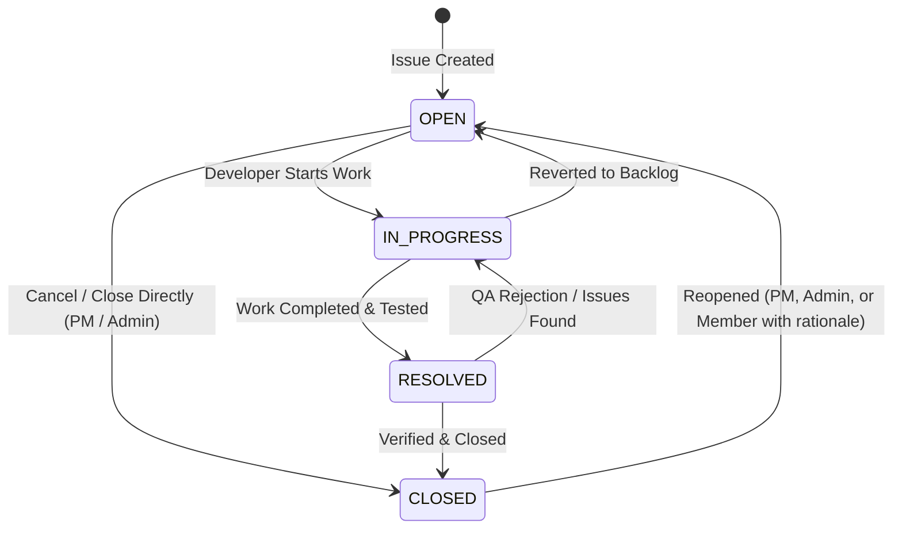

# AI Issue Management System — Backend API

A production-grade, secure, modular monolith backend for the **AI Issue Management System** built with **Java 21**, **Spring Boot 4.x**, **Spring AI**, **Google Gemini GenAI**, **Qdrant Vector Database**, **Redis Semantic Cache**, **PostgreSQL**, **Spring Security (JWT)**, and **OpenAPI/Swagger UI**.

---

## 1. Architecture Overview (Modular Monolith)

The backend is engineered as a Spring Boot modular monolith. Each business capability resides in a strictly bounded module with its own entities, DTOs, repositories, services, and REST controllers:

```
com.issuemanagement
├── assistant       # AI Conversational Assistant, Redis memory, semantic cache, function tools
│   ├── cache       # Redis-based semantic cache with cosine similarity matching
│   ├── config      # Assistant configuration & memory settings
│   ├── controller  # AssistantController (conversations, messages, session, cache metrics)
│   ├── dto         # Chat request/response DTOs, cache metrics
│   ├── exception   # Assistant-specific exceptions
│   ├── model       # AssistantConversation & AssistantMessage entities
│   ├── service     # AssistantConversationService & AssistantToolService
│   └── tools       # Spring AI function-calling tools (IssueQuery, ProjectQuery, etc.)
├── audit           # Administrative system-wide audit logging
├── comment         # Issue discussion threads and authorization checks
├── common          # Shared utilities, OpenAPI configuration, standard API envelopes, global error handling
│   ├── config      # OpenApiConfig, AiConfig (Qdrant & ChatClient beans), SecurityConfig
│   ├── dto         # ApiResponse<T>, PageResponse<T>
│   └── exception   # GlobalExceptionHandler, ResourceNotFoundException, UnauthorizedException
├── dashboard       # High-performance zero N+1 metrics aggregation for Employee & PM views
├── history         # Immutable issue audit trail (status transitions, priority edits, assignee shifts)
├── identity        # Authentication, JWT tokens, user lifecycle, and role-based access control (RBAC)
├── issue           # Issue lifecycle, sequence key generation, FSM transitions, AI semantic search & drafting
│   ├── ai          # Semantic issue deduplication, Qdrant vector sync, and AI drafting service
│   ├── controller  # IssueController, AiIssueController
│   ├── dto         # Issue requests, responses, filters, and AI drafts
│   ├── entity      # Issue, IssueType, IssuePriority, IssueStatus
│   └── repository  # IssueRepository with optimized JPQL queries
└── project         # Project lifecycle, PM assignment, employee membership, and access gating
```

---

## 2. Technology Stack & Key Components

| Technology | Purpose | Configuration Details |
|---|---|---|
| **Java 21 LTS** | Core Runtime | Modern language features (Records, Pattern Matching, Virtual Threads ready) |
| **Spring Boot 4.1.x** | Core Framework | Web MVC, Security, Actuator, Validation |
| **Spring AI 2.0.x** | AI Abstractions | ChatClient, Google GenAI Chat & Embeddings, Vector Store |
| **Google Gemini 2.5 Flash** | Primary LLM | High-speed, context-aware reasoning and function tool execution |
| **Google Text-Embedding-004** | Vector Embeddings | 3072-dimensional vector embeddings for issues and chat context |
| **Qdrant Vector DB 1.18** | Vector Storage | gRPC client, HNSW indexing, cosine distance for semantic deduplication |
| **Redis 7.4 (Upstash ready)** | Memory & Cache | Sliding-window conversation memory & semantic response cache |
| **PostgreSQL 16+ (Neon ready)**| Relational Store | ACID-compliant storage, HikariCP connection pooling with keep-alive |
| **Spring Security & JJWT** | Authentication | Stateless JWT Bearer tokens (256-bit HMAC-SHA), role-based auth |
| **Springdoc OpenAPI 2.8.5** | Documentation | Swagger UI & OpenAPI v3 specs at `/swagger-ui.html` |
| **Spring Boot Actuator** | Observability | Health probes (`/actuator/health`), metrics, and info endpoints |

---

## 3. Business Roles & Permission Matrix

The system enforces a strict Role-Based Access Control (RBAC) model across three distinct roles:

| Capability / Action | ADMIN | PROJECT_MANAGER | EMPLOYEE |
|---|:---:|:---:|:---:|
| **Authentication & Profile** |
| Login / Refresh Token | Yes | Yes | Yes |
| Force Password Change on First Login | Enforced | Enforced | Enforced |
| Update Personal Profile & Password | Yes | Yes | Yes |
| **User Management** |
| Register Initial Admin (Bootstrap) | First user only | No | No |
| Create New Users (PM / Employee) | Yes | No | No |
| Activate / Deactivate Accounts | Yes | No | No |
| View System Users & Role Filters | Yes | No | No |
| **Project Management** |
| Create New Project | Yes | No | No |
| Assign / Reassign Project Manager | Yes | No | No |
| Archive Project | Yes | No | No |
| View Projects | All Projects | Managed Projects Only | Member Projects Only |
| Update Project Name & Description | Yes | Assigned Project Only | No |
| Add / Remove Regular Project Members | Across All Projects | Assigned Project Only | No |
| **Issue Tracking & Workflow** |
| Create Issue in Project | Yes | Assigned Project | Member Projects |
| View Issues | All Issues | Assigned Projects | Member Projects |
| Assign / Reassign Issue to Member | Yes | Assigned Project Only | No |
| Update Issue Details (Title, Description, Priority)| Yes | Assigned Project | Reporter / Assignee |
| Transition Issue Status (FSM Rules) | Yes | Assigned Project | Reporter / Assignee |
| Reopen Closed Issue (`CLOSED` -> `OPEN`) | Yes | Assigned Project | Member with Reason |
| Archive / Soft-Delete Issue | Yes | Assigned Project Only | No |
| Add Comment to Issue | Yes | Assigned Project | Member Projects |
| Edit / Delete Comment | Admin / Author | Assigned Project / Author | Author Only |
| View Complete Issue History Trail | Yes | Assigned Project | Member Projects |
| **AI Features** |
| Chat with AI Assistant | Yes | Yes | Yes (Project-scoped) |
| Semantic Similar-Issue Search | Yes | Yes | Yes (Member Projects) |
| Natural Language Issue Drafting | Yes | Yes | Yes |
| Sync / Re-index Qdrant Vectors | Yes | Assigned Project Only | No |
| View Semantic Cache Performance Metrics | Yes | No | No |
| **Governance & Audit** |
| View System-Wide Audit Logs | Yes | No | No |

---

## 4. Workflow & Issue Finite State Machine (FSM)

Issue status transitions are governed by an automated, validated state machine. Illegal status hops are rejected with `400 Bad Request`.



### Transition Specifications:
- **`OPEN`**: Can transition to `IN_PROGRESS` or `CLOSED`.
- **`IN_PROGRESS`**: Can transition to `RESOLVED` or revert to `OPEN`.
- **`RESOLVED`**: Can transition to `CLOSED` or revert to `IN_PROGRESS`.
- **`CLOSED`**: Terminal state. Can only be reopened back to `OPEN` with an audit comment explaining why.

---

## 5. AI Architecture & Vector Search

The backend integrates Spring AI with Google Gemini and Qdrant Vector DB:

### 5.1 Semantic Deduplication & Similar Issue Search
- When an issue is created or typed, the title and description are converted into a **3072-dimensional vector embedding** using Google's `text-embedding-004`.
- The embedding is queried against Qdrant via gRPC with a project-level filter (`projectId == <id>`).
- If an existing issue exceeds the similarity threshold, it is returned with a similarity score, allowing the user to view or reopen the existing issue instead of creating duplicates.

### 5.2 AI Issue Drafting
- Converts raw natural language bug reports or user requests into a structured draft (title, type, priority, formatted markdown description, and suggested tags) using `gemini-2.5-flash`.

### 5.3 Conversational AI Assistant
- Multi-turn conversation management with a configurable sliding-window memory (default: last 30 messages) stored in Redis with an automated TTL.
- **Tool Calling (Function Calling):** The LLM autonomously executes backend tools to fetch issue details, search across accessible projects, check member workloads, and inspect history without exposing sensitive data outside project boundaries.
- **Redis Semantic Cache:** Caches responses using vector embeddings. If a user asks a semantically equivalent query (`similarity >= 0.88`), the cached response is returned in milliseconds, saving LLM tokens and API latency.

---

## 6. Dashboards & Metric Aggregations

Designed with **zero N+1 queries** using custom JPQL projections and database aggregations:

### 6.1 Employee Dashboard (`GET /api/v1/dashboard/employee`)
- **Strict Isolation:** Sourced directly from the authenticated JWT principal.
- **Metrics:** `totalAssignedIssues`, per-status counts (`open`, `inProgress`, `resolved`, `closed`), and urgent active counts (`highPriorityActive`, `criticalPriorityActive`).
- **Priority Worklist:** Returns prioritized active issues sorted deterministically (`CRITICAL` -> `HIGH` -> `MEDIUM` -> `LOW`, secondary sort by `createdAt DESC`).

### 6.2 Project Manager Dashboard (`GET /api/v1/projects/{projectId}/dashboard`)
- **Access Check:** Only accessible by `ADMIN` or the assigned `PROJECT_MANAGER`.
- **Reconciled Totals:** `totalIssues == open + inProgress + resolved + closed`.
- **Triage Queue:** Prioritized list of unassigned active issues (`OPEN` and `IN_PROGRESS` where `assignee IS NULL`).
- **Team Workload Breakdown:** Per-member breakdown of active assignments, high-priority counts, and resolution rates.

---

## 7. Lifecycle & Assignment Cleanup Cascades

- **Project Member Removal (`DELETE /api/v1/projects/{projectId}/members/{userId}`):**
  - All `OPEN` and `IN_PROGRESS` issues assigned to that user in the project are unassigned (`assignee = null`).
  - `RESOLVED` and `CLOSED` issues remain attributed to preserve historical accountability.
  - Automatically appends an `ASSIGNEE_CHANGED` history entry and records a `MEMBER_REMOVED` audit log.
- **Account Deactivation (`PATCH /api/v1/users/{userId}/status`):**
  - Immediate token invalidation: existing JWTs fail validation.
  - All active issues across all projects assigned to the user are unassigned in a single atomic transaction.

---

## 8. REST API Reference

Swagger UI is accessible at `http://localhost:8080/swagger-ui.html`.

### 8.1 Authentication & User Management
| Method | Endpoint | Description | Access |
|---|---|---|---|
| `POST` | `/api/v1/auth/register-admin` | Bootstrap initial system admin | Public (Once) |
| `POST` | `/api/v1/auth/login` | Authenticate & obtain JWT | Public |
| `POST` | `/api/v1/auth/change-password` | Force password reset on first login | Authenticated |
| `POST` | `/api/v1/users` | Create new PM or Employee | Admin |
| `GET` | `/api/v1/users` | List users with role filter & pagination | Admin |
| `GET` | `/api/v1/users/{id}` | Get user profile details | Admin / Self |
| `PATCH`| `/api/v1/users/{id}` | Update profile details | Admin / Self |
| `PATCH`| `/api/v1/users/{id}/status` | Activate or deactivate account | Admin |
| `GET` | `/api/v1/users/eligible/employees` | List active employees for project assignment | Admin / PM |
| `GET` | `/api/v1/users/eligible/managers` | List eligible project managers | Admin |

### 8.2 Project Management
| Method | Endpoint | Description | Access |
|---|---|---|---|
| `POST` | `/api/v1/projects` | Create project with assigned PM | Admin |
| `GET` | `/api/v1/projects` | List projects scoped to user role | All (Scoped) |
| `GET` | `/api/v1/projects/{id}` | Get project details | Authorized |
| `PATCH`| `/api/v1/projects/{id}` | Update project name or description | Admin / Assigned PM |
| `PUT` | `/api/v1/projects/{id}/manager` | Reassign project manager | Admin |
| `GET` | `/api/v1/projects/{id}/members` | List members of project | Project Members |
| `POST` | `/api/v1/projects/{id}/members` | Add employee to project | Admin / Assigned PM |
| `DELETE`| `/api/v1/projects/{id}/members/{uid}` | Remove employee (cleans active assignments) | Admin / Assigned PM |
| `POST` | `/api/v1/projects/{id}/archive` | Archive project | Admin |

### 8.3 Issue Management & Workflow
| Method | Endpoint | Description | Access |
|---|---|---|---|
| `POST` | `/api/v1/projects/{id}/issues` | Create new issue with sequence key | Member / PM / Admin |
| `GET` | `/api/v1/projects/{id}/issues` | Filterable paginated issue list | Member / PM / Admin |
| `GET` | `/api/v1/issues/{id}` | Get issue details | Project Members |
| `PATCH`| `/api/v1/issues/{id}` | Update title, description, priority | Reporter / Assignee / PM / Admin |
| `PUT` | `/api/v1/issues/{id}/assignee` | Assign/reassign issue to member | Admin / Assigned PM |
| `PATCH`| `/api/v1/issues/{id}/status` | Transition issue status (FSM) | Reporter / Assignee / PM / Admin |
| `POST` | `/api/v1/issues/{id}/reopen` | Reopen closed issue with reason comment | Active Project Members |
| `DELETE`| `/api/v1/issues/{id}` | Soft delete / archive issue | Admin / Assigned PM |
| `GET` | `/api/v1/issues/{id}/history` | Audit trail of all field changes | Project Members |

### 8.4 AI & Semantic Capabilities
| Method | Endpoint | Description | Access |
|---|---|---|---|
| `POST` | `/api/v1/projects/{id}/issues/ai/search-similar` | Semantic deduplication search via Qdrant | Project Members |
| `POST` | `/api/v1/projects/{id}/issues/ai/draft` | Generate structured issue draft from prompt | Project Members |
| `POST` | `/api/v1/projects/{id}/issues/ai/sync-vectors` | Re-index project issues into Qdrant | Admin / Assigned PM |
| `POST` | `/api/v1/assistant/conversations` | Create new AI chat conversation | Authenticated |
| `GET` | `/api/v1/assistant/conversations` | List user's conversations | Authenticated |
| `GET` | `/api/v1/assistant/conversations/{id}/messages` | Get message history in thread | Authenticated |
| `POST` | `/api/v1/assistant/conversations/{id}/messages` | Send message & receive AI reply | Authenticated |
| `DELETE`| `/api/v1/assistant/conversations/{id}` | Delete conversation thread | Authenticated |
| `DELETE`| `/api/v1/assistant/session` | Clear current chat session memory | Authenticated |
| `GET` | `/api/v1/assistant/cache/metrics` | View Redis semantic cache hit/miss stats | Admin |

### 8.5 Comments, Dashboards & Audit
| Method | Endpoint | Description | Access |
|---|---|---|---|
| `POST` | `/api/v1/issues/{id}/comments` | Add comment to issue | Project Members |
| `GET` | `/api/v1/issues/{id}/comments` | List issue comments | Project Members |
| `PATCH`| `/api/v1/comments/{id}` | Edit comment | Author Only |
| `DELETE`| `/api/v1/comments/{id}` | Delete comment | Author / PM / Admin |
| `GET` | `/api/v1/dashboard/employee` | Personal workload dashboard | Authenticated |
| `GET` | `/api/v1/projects/{id}/dashboard`| PM operational project dashboard | Admin / Assigned PM |
| `GET` | `/api/v1/audit-logs` | Query system audit logs | Admin |

---

## 9. Environment Variables & Configuration

Configure using `.env` or system environment variables:

```bash
# Server Configuration
SERVER_PORT=8080
SPRING_PROFILES_ACTIVE=prod

# PostgreSQL Database (Local or Neon Serverless)
SPRING_DATASOURCE_URL=jdbc:postgresql://localhost:5432/issue_management
SPRING_DATASOURCE_USERNAME=postgres
SPRING_DATASOURCE_PASSWORD=your_password
SPRING_JPA_HIBERNATE_DDL_AUTO=update

# Database Connection Pool (HikariCP)
DB_POOL_MAX=10
DB_POOL_MIN_IDLE=2
DB_POOL_IDLE_TIMEOUT=300000
DB_POOL_MAX_LIFETIME=600000
DB_POOL_CONNECTION_TIMEOUT=30000
DB_POOL_KEEPALIVE_TIME=120000

# Redis (Local or Upstash)
REDIS_URL=redis://localhost:6379
# Alternatively:
REDIS_HOST=localhost
REDIS_PORT=6379
REDIS_PASSWORD=
REDIS_SSL_ENABLED=false

# Qdrant Vector Database (Local or Qdrant Cloud)
QDRANT_HOST=localhost
QDRANT_PORT=6334
QDRANT_API_KEY=
QDRANT_USE_TLS=false
QDRANT_COLLECTION=issues

# Security & JWT (256-bit key)
JWT_SECRET=404E635266556A586E3272357538782F413F4428472B4B6250645367566B5970
JWT_EXPIRATION_MS=86400000

# CORS Allowed Origins (Comma-separated)
CORS_ALLOWED_ORIGINS=http://localhost:5173,http://localhost:3000,http://localhost:80

# Google Gemini AI Integration
GEMINI_API_KEY=your_gemini_api_key_here
GEMINI_API_EMBEDDING_KEY=your_gemini_api_key_here
GEMINI_MODEL=gemini-2.5-flash
GEMINI_EMBEDDING_MODEL=text-embedding-004

# Assistant Memory & Semantic Cache
ASSISTANT_MAX_MESSAGES=30
ASSISTANT_CONVERSATION_TTL_SECONDS=86400
ASSISTANT_MAX_USER_MESSAGE_LENGTH=4000
ASSISTANT_SEMANTIC_CACHE_ENABLED=true
ASSISTANT_SEMANTIC_CACHE_TTL_SECONDS=3600
ASSISTANT_SEMANTIC_CACHE_THRESHOLD=0.88
```

---

## 10. Local Development & Setup

### Prerequisites
- **Java 21 JDK** (Eclipse Temurin, Corretto, or Oracle)
- **Docker & Docker Compose** (for running PostgreSQL, Redis, and Qdrant locally)
- **Maven 3.9+** (or use the included `./mvnw.cmd` / `./mvnw`)

### Quick Start with Docker Dependencies
From the repository root, start PostgreSQL, Redis, and Qdrant:
```bash
docker compose up -d postgres redis qdrant
```

### Build & Run the Backend
```bash
# 1. Navigate to the backend directory
cd issueManagement

# 2. Run automated test suite
.\mvnw.cmd test

# 3. Build executable JAR
.\mvnw.cmd package -DskipTests

# 4. Start the Spring Boot application
.\mvnw.cmd spring-boot:run
```

Once started, explore the interactive API documentation at:
**`http://localhost:8080/swagger-ui.html`**

---

## 11. Automated Testing

The backend includes a comprehensive automated test suite covering unit, integration, and security tests:

```bash
.\mvnw.cmd clean test
```

### Key Test Suites:
- **`IssueManagementIntegrationTest`**: End-to-end user workflows, admin bootstrap, first-login password enforcement, and token invalidation on deactivation.
- **`IssueStatusTransitionTest`**: Finite state machine validation for allowed and forbidden transitions.
- **`DashboardServiceTest`**: Verification of zero N+1 metrics aggregations, urgent issue triage, and workload calculations.
- **`ProjectServiceTest` & `UserServiceTest`**: RBAC checks, cross-project isolation, and cascade cleanup logic.
- **`JwtTokenProviderTest`**: Secret entropy validation and token parsing.

---

## 12. Production Deployment

### Docker Deployment
The backend includes a multi-stage `Dockerfile`:
```bash
docker build -t issue-management-api ./issueManagement
docker run -p 8080:8080 --env-file .env issue-management-api
```

### Cloud Deployment (Render)
A turnkey blueprint is configured in `render.yaml`:
1. Connect the repository to **Render**.
2. Select **Web Service** using the Docker runtime.
3. Configure environment variables pointing to:
   - **PostgreSQL**: Managed Neon instance (`sslmode=require`).
   - **Redis**: Upstash Redis with TLS.
   - **Qdrant**: Qdrant Cloud cluster with API key and TLS.
   - **Gemini**: Google AI Studio API key.
